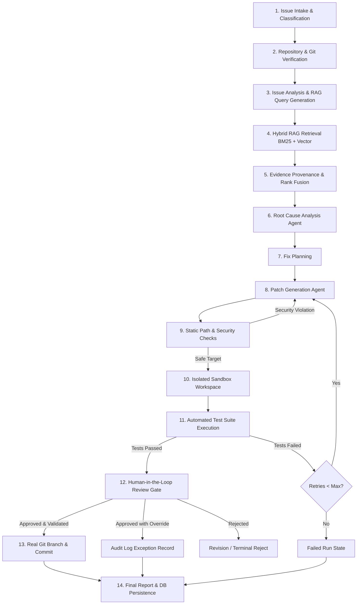

# Multi-Agent RAG Debugger — Workflow Specification

This document details the complete 14-stage workflow powering the Multi-Agent RAG Debugger platform, covering both supervisor-orchestrated and LangGraph-stateful execution modes.

---

## The 14 Logical Workflow Stages

### Stage 1: Issue Intake & Classification
- User submits issue title, natural-language symptoms, and optional stack traces or failing test terminal logs.
- Issue is typed using `IssueRequest` schema with repository directory validation.

### Stage 2: Repository & Git Context Verification
- Target repository directory is checked for existence, directory permissions, and Git initialization (`GitService.is_git_repository`).
- Detects current branch, HEAD commit SHA, working-tree clean status, and detected project framework (Python, Node.js, Rust, Go).

### Stage 3: Issue Analysis & Query Generation
- The `IssueAnalyzer` agent assesses the reported symptoms.
- Categorizes issue type (`bug`, `error`, `performance`, `security`, `test_failure`) and priority (`low`, `medium`, `high`, `critical`).
- Generates targeted retrieval search queries tailored to language keywords and symbols.

### Stage 4: Hybrid RAG Retrieval
- The `RepositoryScanner` inventories files according to exclusion rules (`.git`, virtual environments, cache, binaries).
- `RepositoryLoader` reads file contents and extracts language tags.
- `RepositoryChunker` breaks code into symbol-aware chunks with line number ranges (`start_line`, `end_line`).
- `HybridRetriever` runs both lexical keyword search (`KeywordRetriever`) and semantic vector retrieval (`RepositoryRetriever`).

### Stage 5: Evidence Provenance & Rank Fusion
- `EvidenceRanker` combines keyword and semantic scores using weighted Reciprocal Rank Fusion (RRF).
- Normalizes all evidence paths to be repository-relative (`lf.source = relative.as_posix()`) to prevent local host path exposure.
- Deduplicates chunks and retains top-K evidence with exact line ranges and similarity scores.

### Stage 6: Root Cause Analysis
- The `RootCauseAgent` ingests the issue metadata, analysis, and grounded evidence.
- Explains the technical breakdown, identifies affected files, and computes a confidence score (0.0 to 1.0).
- If evidence is insufficient, it reports insufficient evidence rather than hallucinating defects.

### Stage 7: Fix Planning
- Formulates a minimal diff strategy addressing the causal root cause without side-effects.

### Stage 8: Patch Generation
- The `FixAgent` generates a unified diff patch (`diff --git a/... b/...`).
- Validates JSON output structure against `ProposedFix` schema.
- Re-prompts the model once with explicit validation feedback if schema validation fails.

### Stage 9: Static Path & Security Checks
- `PatchSecurityValidator` checks all `+++` and `---` file targets:
  - Blocks path traversal (`..` and leading `/` or `\`).
  - Blocks sensitive files (`.env`, `id_rsa`, `passwd`, etc.).
  - Blocks script/executable modifications (`.exe`, `.sh`, `.bat`, etc.).
- `PatchApplier.verify_patch_targets` ensures every modified file genuinely exists in the workspace. Patches targeting non-existent files are rejected before execution.

### Stage 10: Isolated Sandbox Workspace
- `WorkspaceSandbox` creates a temporary isolated directory (`tempfile.mkdtemp(prefix="secure-sandbox-")`).
- Copies repository files while excluding `.git`, `.venv`, and node_modules.
- Ensures original developer repository files are never modified during test runs.

### Stage 11: Automated Test Suite Execution
- Applies the verified patch using `git apply`.
- Detects the project test runner (e.g. `pytest -q`, `npm test`, `cargo test`, `go test`).
- Bounded execution with strict timeouts (120 seconds default), capturing exit codes, stdout, and stderr.
- Returns structured `ValidationResult`.

### Stage 12: Human-in-the-Loop Review Gate
- Authorized reviewers review the unified diff and validation logs.
- Authoritative state rules enforce:
  - If validation failed, approval is blocked unless an explicit override reason is submitted.
  - "Ready for branch merge" is ONLY displayed when validation passed AND the patch is approved.
  - All reviewer decisions and override justifications are logged to `approval_records`.

### Stage 13: Real Git Branch & Commit Workflow
- `GitService.create_fix_branch`: safely creates an isolated branch (e.g., `fix/issue-101`) without modifying other branches.
- `GitService.commit_approved_patch`: applies patch, stages ONLY the affected files, and creates a commit with full author provenance.
- Push and merge actions require explicit human trigger.

### Stage 14: Final Report & Database Persistence
- `ReportBuilder` compiles `FinalDebuggingReport`.
- `PersistenceService` saves all traces, evidence items, root-cause findings, patches, validation logs, and approval events into the database.
- Operational metrics are updated.
